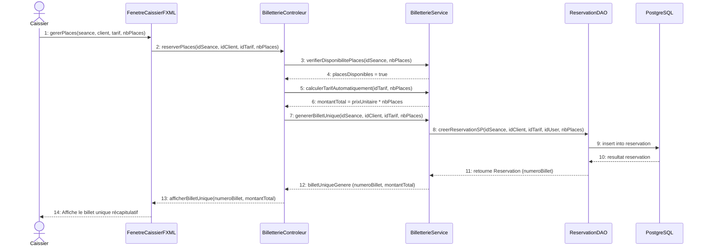
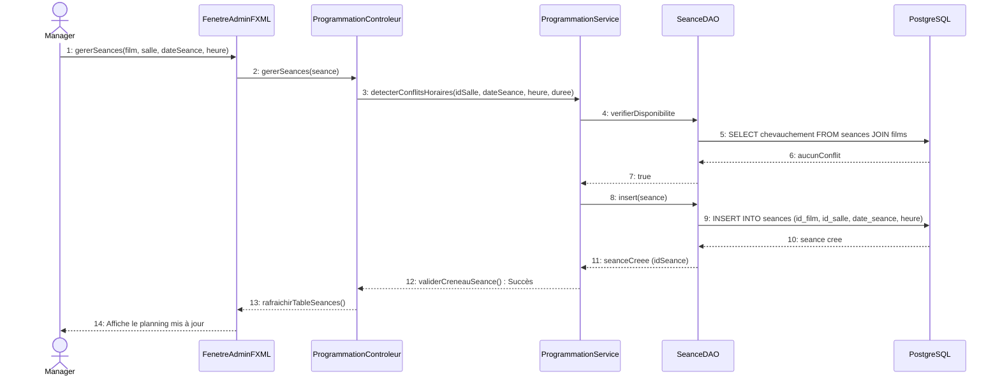
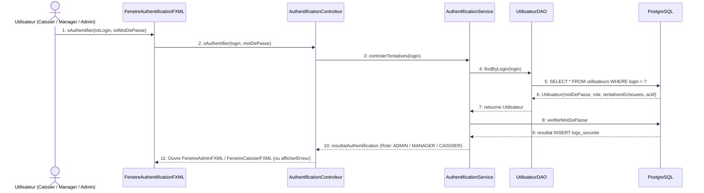

# Dossier de Conception et Base de Données — CineTrack V2 (Étape 1)

**Client :** Cinéma Le Lumière  
**Prestataire :** DevCore (SSII)  
**Projet StarUML de référence :** [CineTrackV2_Complet.mdj](file:///c:/Users/Asus/eclipse-workspace/ProjetCineTrackVraiVrai/diagrammes/CineTrackV2_Complet.mdj)  
**Projet Visual Paradigm de référence :** [CineTrackV2_Complet.vpp](file:///c:/Users/Asus/eclipse-workspace/ProjetCineTrackVraiVrai/diagrammes/CineTrackV2_Complet.vpp)  
**Projet Looping (MCD / MLD) :** [CineTrackV2.loo](file:///c:/Users/Asus/eclipse-workspace/ProjetCineTrackVraiVrai/diagrammes/CineTrackV2.loo)  

**Livrables couverts :**
1. Diagrammes UML (Cas d'utilisation, Classes Entités BDD, Classes Architecture MVC & Services, **Diagrammes de Séquence**)
2. **Modèle Relationnel (MLD — 8 tables)** déduit du diagramme de classes `2_Classes_Entites_BDD`
3. **Création PostgreSQL avec pgAdmin 4**
4. **Scripts SQL (DDL, Triggers, Procédures Stockées, Requêtes Statistiques)**
5. **Jeu de données de test complet**

---

## 1. Récapitulatif des Diagrammes UML (`CineTrackV2_Complet.mdj` & `CineTrackV2_Complet.vpp`)

### 1.1 Diagramme 1 : Cas d'Utilisation (`1_UseCase_CineTrackV2`)
- **3 Acteurs du personnel interne :**
  - **`Caissier`**
  - **`Manager`** (hérite de `Caissier`)
  - **`Administrateur`** (hérite de `Manager`)
- **Cas d'utilisation du `Caissier` (tous incluent `S'authentifier`) :**
  - `Consulter planning`, `Consulter catalogue`, `Rechercher film`, `Rechercher séances`, `Gérer les fiches clients`
  - `Gérer les places` :
    - Étendu (`«extend»`) par **`Réserver des places`** et **`Annuler une réservation`**
    - **`Réserver des places`** inclut (`«include»`) : **`Vérifier disponibilité des places`**, **`Calculer tarif automatiquement`**, **`Générer un billet unique`**
- **Cas d'utilisation du `Manager` (tous incluent `S'authentifier`) :**
  - `Gérer les films` (`«extend»` : `Ajouter des films`, `Supprimer des films`)
  - `Gérer les salles` (`«extend»` : `Ajouter salle`, `Supprimer salle`)
  - `Gérer les séances` (`«extend»` : `Ajouter une séance`, `Modifier séance`, `Supprimer des séances` ; `«include»` : **`Détecter conflits d'horaires`**)
  - `Gérer tarifs`
  - `Consulter statistiques` (`«extend»` : `Exporter rapports`)
- **Cas d'utilisation de l'`Administrateur` (hérite de `Manager`, incluent `S'authentifier`) :**
  - `Gérer les utilisateurs` (`«extend»` : `Ajouter des utilisateurs`, `Supprimer des utilisateurs`)
  - `Consulter les logs de sécurité`
  - `Effectuer une sauvegarde`

### 1.2 Diagramme 2 : Classes Entités BDD (`2_Classes_Entites_BDD`) — 8 Tables
- **8 Classes Entités (entre 5 et 10 tables) :** `Film`, `Salle`, `Seance`, `Client`, `Reservation`, `Tarif`, `Utilisateur`, `LogSecurite`.
- **7 Associations métier et multiplicités :**
  1. `Film` `(1)` — `Est programmé` — `(0..*)` `Seance`
  2. `Salle` `(1)` — `Accueille` — `(0..*)` `Seance`
  3. `Client` `(1)` — `Effectue` — `(0..*)` `Reservation`
  4. `Seance` `(1)` — `Concerne` — `(0..*)` `Reservation`
  5. `Tarif` `(1)` — `Applique` — `(0..*)` `Reservation`
  6. `Utilisateur` `(1)` — `Gère` — `(0..*)` `Reservation`
  7. `Utilisateur` `(0..1)` — `Journalise` — `(0..*)` `LogSecurite`

### 1.3 Diagramme 3 : Classes Architecture MVC & Services (`3_Classes_Architecture_MVC_Services`)
- **Couche Vue (FXML) :** `FenetreAuthentificationFXML`, `FenetreCaissierFXML`, `FenetreAdminFXML`, `FenetreStatsEtSecuriteFXML`
- **Couche Contrôleur :** `AuthentificationControleur`, `BilletterieControleur`, `ProgrammationControleur`, `StatistiqueControleur`
- **Couche Service Métier :** `AuthentificationService`, `BilletterieService`, `ProgrammationService`, `StatistiqueEtSauvegardeService` (implémente `IExportService`)
- **Couche Accès aux Données (DAO) :** `UtilisateurDAO`, `ReservationDAO`, `SeanceDAO`, `StatistiqueEtLogDAO` (implémentent `IDAO<T>`), connectés à `DatabaseConnection`
- **Exceptions Métier :** `CineTrackException` $\leftarrow$ `ConflitHoraireException`, `PlaceIndisponibleException`

---

## 2. Diagrammes de Séquence UML

### 2.1 Séquence 1 (`4_Sequence_ReserverPlaces_Billet`) : Réserver des places et Générer un billet unique
Basé sur le cas d'utilisation **`Gérer les places` $\rightarrow$ `Réserver des places`** (acteur `Caissier`) et les classes **`FenetreCaissierFXML` $\rightarrow$ `BilletterieControleur` $\rightarrow$ `BilletterieService` $\rightarrow$ `ReservationDAO` $\rightarrow$ `PostgreSQL`**.

### 2.2 Séquence 2 (`5_Sequence_GererSeances_Conflits`) : Gérer les séances et Détecter les conflits d'horaires
Basé sur le cas d'utilisation **`Gérer les séances` $\rightarrow$ `Ajouter une séance`** (acteur `Manager`) et les classes **`FenetreAdminFXML` $\rightarrow$ `ProgrammationControleur` $\rightarrow$ `ProgrammationService` $\rightarrow$ `SeanceDAO` $\rightarrow$ `PostgreSQL`**.

### 2.3 Séquence 3 (`6_Sequence_SAuthentifier_Securite`) : S'authentifier, Contrôle BCrypt et Blocage après 3 échecs
Basé sur le cas d'utilisation **`S'authentifier`** (inclus dans toutes les opérations de `Caissier`, `Manager` et `Administrateur`).

---

## 3. Modèle Relationnel (MLD — 8 Tables)

Ce Modèle Relationnel comporte **8 tables** (respectant la contrainte de **minimum 5 tables et maximum 10 tables**) et découle directement du diagramme **`2_Classes_Entites_BDD`** :
- Les **clés primaires (PK)** sont **<u>soulignées</u>**.
- Les **clés étrangères (FK)** sont précédées du symbole **`#`**.

### 3.1 Schéma Relationnel Textuel (8 Tables)

1. **`UTILISATEURS`** (<u>`id_utilisateur`</u>, `login`, `mot_de_passe`, `nom`, `prenom`, `role`, `tentatives_echouees`, `actif`, `date_derniere_connexion`)
2. **`SALLES`** (<u>`id_salle`</u>, `nom`, `capacite`, `equipement`)
3. **`FILMS`** (<u>`id_film`</u>, `titre`, `genre`, `duree`, `note`, `synopsis`)
4. **`SEANCES`** (<u>`id_seance`</u>, `#id_film`, `#id_salle`, `date_seance`, `heure`, `places_dispo`)
   - *Clés étrangères :* `#id_film` $\rightarrow$ `FILMS(id_film)` (*Est programmé*), `#id_salle` $\rightarrow$ `SALLES(id_salle)` (*Accueille*)
5. **`CLIENTS`** (<u>`id_client`</u>, `nom`, `prenom`, `email`, `telephone`, `date_inscription`)
6. **`TARIFS`** (<u>`id_tarif`</u>, `categorie`, `libelle`, `prix_unitaire`, `description`, `actif`)
7. **`RESERVATIONS`** (<u>`id_reservation`</u>, `numero_billet`, `#id_seance`, `#id_client`, `#id_tarif`, `#id_utilisateur`, `nb_places`, `montant_total`, `date_reservation`, `statut`)
   - *Clés étrangères :*
     - `#id_seance` $\rightarrow$ `SEANCES(id_seance)` (*Concerne*)
     - `#id_client` $\rightarrow$ `CLIENTS(id_client)` (*Effectue*)
     - `#id_tarif` $\rightarrow$ `TARIFS(id_tarif)` (*Applique*)
     - `#id_utilisateur` $\rightarrow$ `UTILISATEURS(id_utilisateur)` (*Gère*)
8. **`LOGS_SECURITE`** (<u>`id_log`</u>, `#id_utilisateur`, `utilisateur_login`, `action`, `table_concernee`, `donnees_concernees`, `date_heure`)
   - *Clé étrangère :* `#id_utilisateur` $\rightarrow$ `UTILISATEURS(id_utilisateur)` (*Journalise*, cardinalité `0..1`)

### 3.2 Tableau de correspondance Classes UML (`2_Classes_Entites_BDD`) $\leftrightarrow$ Tables PostgreSQL

| # | Classe UML | Table PostgreSQL | Clé Primaire (PK) | Clés Étrangères (FK) | Contraintes Métier (`CHECK` / `UNIQUE`) |
| :-: | :--- | :--- | :--- | :--- | :--- |
| 1 | `Utilisateur` | `utilisateurs` | `id_utilisateur` (`SERIAL`) | — | `login UNIQUE`, `role IN ('ADMIN', 'MANAGER', 'CAISSIER')`, `tentatives_echouees >= 0` |
| 2 | `Salle` | `salles` | `id_salle` (`SERIAL`) | — | `nom UNIQUE`, `capacite > 0` |
| 3 | `Film` | `films` | `id_film` (`SERIAL`) | — | `duree > 0`, `note BETWEEN 0 AND 10` |
| 4 | `Seance` | `seances` | `id_seance` (`SERIAL`) | `id_film`, `id_salle` | `places_dispo >= 0`, `UNIQUE(id_salle, date_seance, heure)` |
| 5 | `Client` | `clients` | `id_client` (`SERIAL`) | — | `email UNIQUE` |
| 6 | `Tarif` | `tarifs` | `id_tarif` (`SERIAL`) | — | `categorie UNIQUE`, `prix_unitaire >= 0` |
| 7 | `Reservation` | `reservations` | `id_reservation` (`SERIAL`) | `id_seance`, `id_client`, `id_tarif`, `id_utilisateur` | `numero_billet UNIQUE`, `nb_places > 0`, `montant_total >= 0`, `statut IN ('CONFIRMEE', 'ANNULEE')` |
| 8 | `LogSecurite` | `logs_securite` | `id_log` (`SERIAL`) | `id_utilisateur` (nullable) | Journalisation automatique des opérations sensibles (CC4) |

---

## 4. Création PostgreSQL avec pgAdmin 4

1. Ouvrir **pgAdmin 4** et se connecter au serveur local **PostgreSQL** (`localhost:5432`).
2. Clic droit sur **Databases** $\rightarrow$ **Create** $\rightarrow$ **Database...** :
   - **Database :** `projetcinetrackv2` (ou `ProjetCineTrack`) $\rightarrow$ **Save**.
3. Clic droit sur la base $\rightarrow$ **Query Tool** (Outil de requête).
4. Ouvrir le fichier tout-en-un [v2_script_complet_pgadmin.sql](file:///c:/Users/Asus/eclipse-workspace/ProjetCineTrackVraiVrai/sql/v2_script_complet_pgadmin.sql) et cliquer sur **Execute Script (F5)**.
5. Pour afficher le schéma relationnel (ERD) dans pgAdmin 4 :
   - Clic droit sur la base $\rightarrow$ **ERD for Database**.

---

## 5. Scripts SQL et Données de Test

| Script SQL | Rôle et contenu |
| :--- | :--- |
| [v2_create_tables.sql](file:///c:/Users/Asus/eclipse-workspace/ProjetCineTrackVraiVrai/sql/v2_create_tables.sql) | Création des **8 tables** (`utilisateurs`, `salles`, `films`, `seances`, `clients`, `tarifs`, `reservations`, `logs_securite`), clés primaires/étrangères, contraintes `CHECK`/`UNIQUE` et index. |
| [v2_triggers_procedures.sql](file:///c:/Users/Asus/eclipse-workspace/ProjetCineTrackVraiVrai/sql/v2_triggers_procedures.sql) | **Triggers** (`trg_verif_conflit_seance`, `trg_maj_places_reservation`, `trg_historique_tarifs`, `trg_log_suppression_film`/`salle`) et **3 Procédures Stockées** (`sp_creer_reservation`, `sp_annuler_reservation`, `sp_enregistrer_tentative_connexion`). |
| [v2_insert_data.sql](file:///c:/Users/Asus/eclipse-workspace/ProjetCineTrackVraiVrai/sql/v2_insert_data.sql) | **Données de test complètes** : 5 utilisateurs (`admin`, `manager1`, `caissier1..3` avec BCrypt), 4 salles, 8 films, 4 tarifs, 14 séances, 6 clients, 6 réservations (dont 1 annulée) et logs de sécurité. |
| [v2_requetes_statistiques.sql](file:///c:/Users/Asus/eclipse-workspace/ProjetCineTrackVraiVrai/sql/v2_requetes_statistiques.sql) | Requêtes d'exploitation pour `StatistiqueEtLogDAO` : Top films réservés, taux d'occupation par salle/séance, chiffre d'affaires par jour/mois, consultation de `logs_securite`. |
| [v2_script_complet_pgadmin.sql](file:///c:/Users/Asus/eclipse-workspace/ProjetCineTrackVraiVrai/sql/v2_script_complet_pgadmin.sql) | **Script complet unifié** regroupant la création des 8 tables, les triggers, les procédures stockées, les données de test et les requêtes de vérification pour pgAdmin 4. |
